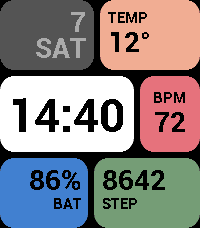
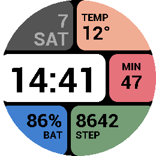
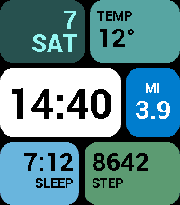
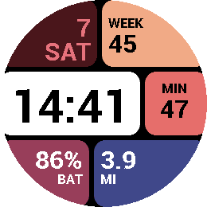

# Tiles

*Big, bold colour tiles: the time, the date and four values you choose.*

 
 

A Pebble watchface (v1.0.0) for Pebble Time 2 (emery) and Pebble Round 2 (gabbro).
Six rounded colour blocks: the date top left, the time in the white centre tile,
and four tiles with a value of your choice.

## Settings

- **Colour scheme** - Classic, Ocean, Sunset or Mono.
- **Top right / Middle right / Bottom left / Bottom right** - one of:
  temperature, heart rate, active minutes, battery, steps, distance, sleep, week number.
  Defaults: temperature, heart rate, battery, steps.
- **Temperature unit** - automatic (phone region), Celsius or Fahrenheit.

Heart rate exists only on Pebble Time 2; on Pebble Round 2 a heart rate tile
shows active minutes instead. Weather comes from [Open-Meteo](https://open-meteo.com/)
(no API key), requested by the watch every 30 minutes and shown as `--°` once it is
older than two hours. 12/24 h and km/mi follow the watch settings.

## Building

Requires the [Pebble SDK](https://developer.repebble.com/sdk/).

```bash
pebble build
pebble install --emulator gabbro
```

Store screenshots use fixed sample values: `screenshots/presets.json` sends the
`DEMO` key, which the watch keeps in memory only (never persisted).

## Release notes

### 1.0.0

First release.

## Status

- 1.0.0 published on 2026-11-07: https://apps.rePebble.com/0eadc6f30da04ae293b0cfb1
- 1.0.0 complete on emery and gabbro: layout, four configurable tiles, four colour
  schemes, weather via PebbleKit JS, demo mode for screenshots.
- Font: Roboto Bold in three sizes per platform (time 58/46, values 32/28,
  labels 17/15 px for gabbro/emery). Values too wide for their tile fall back to
  Gothic bold.
- Open ideas: faint background icons in the tiles (shoe, heart, sun), a
  Home Assistant sensor as tile source, ports to chalk/basalt.

## Credits

- Font: Roboto by Christian Robertson, Apache License 2.0

## License

MIT, see [LICENSE](LICENSE).
